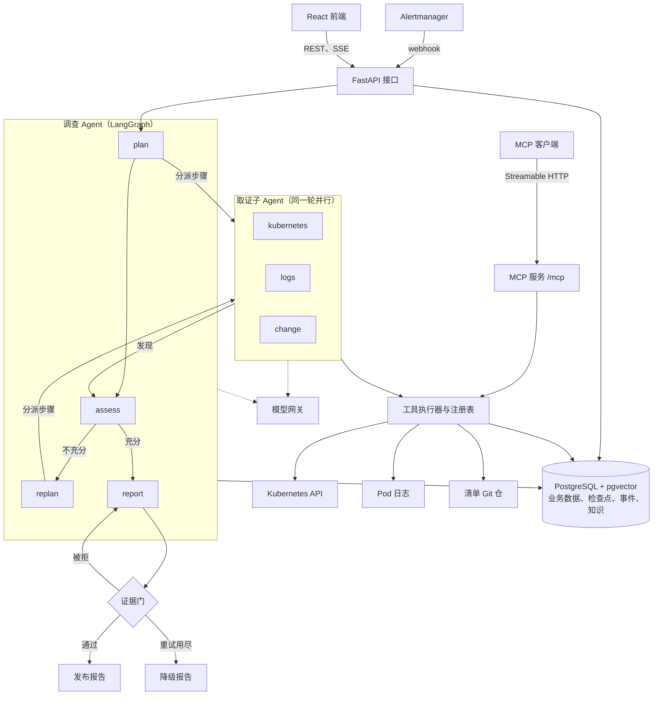

# 扁鹊 Bianque

Bianque is an alert-driven root cause analysis agent for Kubernetes. When Alertmanager fires an alert, Bianque plans an investigation, dispatches three evidence sub-agents that collect evidence in parallel with read-only tools, and publishes a report in which every conclusion cites the evidence it rests on; a deterministic evidence gate checks every model output before it is shown. Bianque only reads: it never changes the cluster or the manifest repository, and a remediation suggestion that a person confirms is recorded, not executed.

扁鹊接收 Alertmanager 的告警后建立一次调查：调查 Agent 先制定调查计划，把步骤按证据域分派给 `kubernetes`、`logs`、`change` 三个取证子 Agent 并行取证；每轮取证后由调查 Agent 判断证据是否充分，不充分就补充计划再取证；最后生成根因报告，报告里每条结论都引用证据编号。计划、判断、发现、报告与追问回答在展示前都要通过证据门的确定性校验，报告重试后仍不通过时只发布降级报告。报告发布后可以围绕它追问，回答只用已有证据；对修复建议的确认或驳回只记录决定，不执行任何操作。

## 架构



- 调查图在 `backend/bianque/agents/graph.py`，节点在 `nodes.py`，取证子 Agent 在 `subagent.py`。三个取证子 Agent 是同一份实现，区别只在证据域。
- 工具执行器（`backend/bianque/tools/executor.py`）是调用工具的唯一入口，取证子 Agent 与 MCP 服务共用它与注册表（`backend/bianque/tools/registry.py`）。
- 证据门（`backend/bianque/gate/`）只依赖 pydantic 与脱敏引擎，不依赖模型网关；运行时与评测调用同一个 `validate`。
- 模型网关（`backend/bianque/llm/gateway.py`）是访问模型服务的唯一出口，只接受经过脱敏的输入。
- PostgreSQL 是唯一的存储：业务表、LangGraph 检查点（独立的 `langgraph` schema）、进度事件、运维手册的分块与向量都在里面。

组件、数据流与设计取舍见 [`docs/architecture.md`](docs/architecture.md)。架构决策：

- [`docs/adr/0001-multi-agent-evidence-collection.md`](docs/adr/0001-multi-agent-evidence-collection.md)
- [`docs/adr/0002-human-confirmation-records-only.md`](docs/adr/0002-human-confirmation-records-only.md)
- [`docs/adr/0003-single-tool-registry-and-mcp.md`](docs/adr/0003-single-tool-registry-and-mcp.md)
- [`docs/adr/0004-postgresql-only.md`](docs/adr/0004-postgresql-only.md)
- [`docs/adr/0005-recorded-model-responses-for-eval.md`](docs/adr/0005-recorded-model-responses-for-eval.md)

## 能力

每项能力的模块与测试对照见 [`docs/capabilities.md`](docs/capabilities.md)。

- **告警接入**：Alertmanager webhook（`backend/bianque/api/alerts.py`）为每条触发中的告警建立调查，同一指纹的调查未结束时不重复建立；告警原文是调查的第一条证据（`backend/bianque/api/alertmanager.py`）。登录后也可以手动触发调查。
- **规划与执行**：调查 Agent 制定计划、按轮分派、判断证据是否充分、补充计划、生成报告（`backend/bianque/agents/graph.py`、`nodes.py`）。判断由模型给出，再由确定性规则复核；补充计划轮数、子 Agent 步数、报告重试次数与 token 预算都可配置。
- **多源只读取证**：三个证据域共 8 个取证工具，读 Pod、事件、Deployment、容器日志、Deployment 修订历史与清单仓提交（`backend/bianque/tools/`）。每个工具都有读真实集群与清单仓的后端和读证据包的回放后端，回放后端用证据包里的快照回答同样的查询。
- **多 Agent 并行取证**：同一轮的取证子 Agent 在一个 LangGraph superstep 里并行执行，每个步骤是一段 ReAct 对话；一个子 Agent 失败不会使调查失败（`backend/bianque/agents/subagent.py`）。证据域只在 `backend/bianque/agents/domains.py` 声明一次。
- **证据门**：7 个校验器（schema、引用完整性、知识边界、未知纪律、缺失证据一致性、禁止动作、脱敏残留）按输出类型组成校验清单（`backend/bianque/gate/checklists.py`）。被拒的输出带校验器名称重试，报告重试用尽后发布降级报告（`backend/bianque/gate/degrade.py`）。
- **追问与记忆**：追问只用该调查已有的证据、报告与修复建议，回答通过证据门之后才分段推送（`backend/bianque/agents/followup.py`）。会话记忆就是数据库里的问答轮次，后端重启后照常回答。
- **知识检索（RAG）**：运维手册按标题分块，向量检索（pgvector）与全文检索用 RRF 融合（`backend/bianque/knowledge/search.py`）。知识只作参考资料，证据门禁止把知识编号当证据引用。
- **MCP 服务**：把注册表里的只读工具经 MCP（Streamable HTTP）提供给 Claude Code 等客户端，令牌绑定允许的工具与命名空间（`backend/bianque/mcp/`）。
- **人工确认**：登录用户对修复建议确认或驳回，每条建议只能决定一次；决定表由数据库触发器保证只追加，扁鹊不执行任何命令。
- **脱敏**：送进模型与展示在界面上的文本都经过脱敏引擎（`backend/bianque/redaction/`）；模型网关在类型检查、运行时与发送前三处拒绝未脱敏的输入。
- **中断与重启**：调查图的状态以 LangGraph 检查点存进 PostgreSQL；后端重启时把未结束的调查标为中断，不续跑。
- **前端**：调查列表、调查详情（流程图、计划与判断、调用时间线、证据、报告与引用跳转、修复建议、追问、调用记录）与登录页（`frontend/src/`）。
- **可观测性**：每次模型、工具与知识调用写一条调用记录（Agent、耗时、重试、token、证据门结果）；进度事件持久化后经 SSE 推送，断线后可以续读。
- **评测**：6 个用例回放录制的真实模型响应，计算根因准确率、引用完整性、必需证据覆盖、追问结果、证据门首次通过率与检索指标，并检查硬性门槛（`backend/bianque/evals/`）。
- **工程化**：静态检查 import 边界、环境变量前缀与 Kubernetes 只读调用；Helm chart 渲染出的 RBAC 只有 get、list、watch；CI 有 6 个任务。

## 演示

三分钟演示在演示形态（本机 kind 集群、真实模型）上进行：

1. `make inject-s1 CASE=a` 向清单仓提交一次改动，把演示应用的 `APP_MODE` 改成非法值，Pod 进入 CrashLoopBackOff。
2. 约 1 分钟后 Alertmanager 把 `BianquePodRestarting` 告警推给扁鹊，调查列表出现一次新调查。
3. 计划第 1 版只有 `kubernetes` 与 `logs` 两个证据域，两个取证子 Agent 并行取证；第 1 轮判断为不充分：配置类根因还缺变更证据。
4. 计划第 2 版加入 `change` 证据域：读修订历史、列出提交、读出改动 `APP_MODE` 的那次提交。
5. 报告通过证据门后发布：根因指向那次提交，点击根因引用的证据编号会跳到提交差异；运维手册单独列在参考资料里。
6. 追问「为什么认定是这次提交」：校验期间只显示进度，通过后带引用的回答分段出现。
7. 确认一条「变更」级修复建议：页面记录操作人与时间，系统不执行命令。
8. 调用记录按 Agent 列出全部模型与工具调用，以及 token 与耗时合计。

## 快速开始

扁鹊有两种运行形态：

- **回放形态**（`make replay`）：不需要集群，默认也不需要模型密钥。工具读 `eval/cases/` 里的证据包，模型响应来自 `eval/recordings/` 里的录制响应。
- **演示形态**（`make demo`）：本机 kind 集群上的真实故障、真实告警与真实模型。

两种形态的页面都只监听 `127.0.0.1`。演示账号是 `demo`，口令在每次启动时随机生成并打印，仓里没有默认口令；每次启动也更换会话签名密钥。查看调查不需要登录；手动触发调查、追问、对修复建议确认或驳回需要登录。

### 回放形态

前置：Docker（含 Compose）。

Docker Compose 起数据库、后端与前端，nginx 提供页面并把 `/api` 代理到后端，页面与接口同源。后端启动后导入 `knowledge/runbooks/` 的运维手册，并对 `eval/cases/` 下每个有证据包的用例各跑一次调查；已经跑过的用例不再重跑。

| 命令 | 作用 |
| --- | --- |
| `make replay` | 构建镜像并启动，健康检查通过后打印地址（默认 `http://127.0.0.1:8080`，`BIANQUE_REPLAY_PORT` 可改）、演示账号口令与接入 MCP 的命令。第一次运行时生成数据库口令，写进被忽略的 `.demo/replay.env` |
| `make replay LLM_MODE=scripted` | 同上，规则响应器代替模型 |
| `make replay LLM_MODE=live LLM_API_KEY_FILE=<密钥文件>` | 同上，调用真实模型 |
| `make replay-down` | 停止并删除容器与数据卷，下次从空数据库开始 |
| `make e2e` | 从空数据库以 `scripted` 模式起回放形态，对启动时现跑的调查与测试中新触发的调查跑 Playwright 端到端测试；宽屏与窄屏、浅色与深色的截图写到 `frontend/e2e/screenshots/` |

模型模式由 `LLM_MODE` 选择：

- `recorded`（默认）：回放录制的真实模型响应，模型名与附加请求体取自录制清单 `eval/recordings/manifest.json`。这一模式下只能按顺序提问用例 `questions.yaml` 里录制过的问题。
- `scripted`：规则响应器代替模型，用于测试，不访问网络。
- `live`：调用真实模型，追问可以自由提问。`LLM_API_KEY_FILE` 指向保存密钥的文件，密钥不进环境变量与镜像；模型默认 DeepSeek `deepseek-v4-pro`，可用 `LLM_MODEL`、`LLM_BASE_URL`、`LLM_EXTRA_BODY` 改。启动前把本地嵌入模型下载到模型卷，运行时不访问外部的嵌入服务。

### 演示形态

前置工具与验证过的版本：

| 工具 | 版本 |
| --- | --- |
| Docker | 29.9 |
| kind | 0.33.0 |
| kubectl | 1.37 |
| Helm | 4.3 |
| jq | 任意版本（`make demo-alerts` 与 `make record-pack` 使用） |

另需一个模型密钥文件（默认 DeepSeek，模型与地址同回放形态的 `live` 模式，可用 `LLM_MODEL`、`LLM_BASE_URL`、`LLM_EXTRA_BODY` 改）。首次 `make demo` 要联网：后端镜像在构建时下载本地嵌入模型并核对 SHA-256，运行时不访问外部的嵌入服务。

```bash
make demo LLM_API_KEY_FILE=<密钥文件>
```

演示形态是一个本机 kind 集群：演示应用 `s1-app`、Prometheus、Alertmanager、kube-state-metrics，以及用 Helm chart（`deploy/helm/bianque`）装进集群的扁鹊（后端、前端、PostgreSQL）。演示应用的清单放在本机的一个 Git 仓里，故障都通过提交清单引入；Alertmanager 把告警推给扁鹊，扁鹊读真实的集群与清单仓，调用真实模型。

完成后打印页面地址 `http://127.0.0.1:8180`（`BIANQUE_DEMO_PORT` 可改，建集群时生效）、演示账号口令与接入 MCP 的命令。口令、会话密钥、MCP 令牌、数据库口令与 Alertmanager 的 webhook 令牌都在本机生成，放在被忽略的 `.demo/kind/`，以 Secret 交给集群，不进 Helm 的 release 记录；模型密钥同样以 Secret 只读挂成文件，不进环境变量与镜像。

| 命令 | 作用 |
| --- | --- |
| `make demo LLM_API_KEY_FILE=<密钥文件>` | 起演示环境（下一行），再构建并载入扁鹊的后端与前端镜像，创建 Secret 与运维手册 ConfigMap，安装或升级 chart，导入运维手册。重复执行只更新有变化的部分，数据库保留 |
| `make demo-env` | 只起演示环境，不装扁鹊：创建 kind 集群 `bianque-demo`，在 `.demo/manifests` 初始化清单仓，构建并载入演示应用镜像，安装 Prometheus 与 Alertmanager，部署演示应用 |
| `make inject-s1 CASE=a` | 注入故障：`a` 把 `APP_MODE` 改成非法值；`b` 把内存限制改小；`c` 把存活检查指向不存在的路径；`e` 先做 `a`，再提交一次无关的改动 |
| `make restore-s1` | 回退注入的提交，等待演示应用恢复 |
| `make demo-alerts` | 列出 Alertmanager 当前的告警 |
| `make record-pack CASE=a` | 录制一个用例的证据包（`a`、`b`、`c`、`e`），只在 `make demo-env` 起的、没有扁鹊的环境里运行：重置 `demo-s1` 到干净的基线，注入故障，取 Alertmanager 发出的第一条告警，把命名空间与清单仓的快照写到 `eval/cases/s1-<用例>/pack/`，跑一遍真实集群上的集成测试，最后恢复 |
| `make derive-packs` | 从 S1-a 的证据包派生 S1-d（回放时日志工具超时）与 S1-f（只留告警与 Pod） |
| `make helm-rbac` | `helm lint`，并确认 chart 渲染出的 RBAC 只有 get、list、watch |
| `make demo-down` | 删除 kind 集群与 `.demo/kind/`；`.demo/` 的其余内容保留，要从头开始就另外删除 `.demo/` |

注入 S1-a 后约 1 分钟（实测 48 至 76 秒）Alertmanager 发出 `BianquePodRestarting` 告警，扁鹊随即开始调查，页面上能看到实时进度与流程图；实测一次 S1-a 调查约 70 秒、40 余次调用、约 10 万 token。告警规则只看 `demo-s1`；扁鹊的 ServiceAccount 只能在 `demo-s1` 里 get、list、watch Pod、Pod 日志、事件、Deployment 与 ReplicaSet，读不到其他命名空间。所有命令都指定 `kind-bianque-demo` 这个 kubectl context，建集群后切回原来的当前 context，不改动其他集群。

内存：kind 节点容器（集群里的全部 Pod 都在其中）在 `make demo` 完成后实测约 1.5 至 1.9 GiB，一次调查之后约 1.7 至 2.1 GiB，其中扁鹊后端加载嵌入模型后约 320 MiB。给 Docker 分 4 GiB 以上即可。

### 证据包

证据包是故障发生时整个演示命名空间（Pod、事件、Deployment、ReplicaSet、全部容器日志）与清单 Git 仓的快照，外加触发调查的那条告警。回放后端从证据包回答工具的任意查询，并把录制时间当作当前时间，所以没有集群也能重跑调查与评测。录制时去掉对象的 `managedFields` 与 `last-applied-configuration` 注解，私有地址泛化为 `10.244.x.x` 的形式，写完再用脱敏规则检查全部文件。

```text
eval/cases/s1-a/pack/
├── meta.json          格式版本、用例、命名空间、录制时间、组件版本
├── alert.json         Alertmanager 的 webhook 请求体
├── k8s/               pods.json、events.json、deployments.json、replicasets.json
├── logs/              <pod>/<container>.log 与 <pod>/<container>.previous.log
├── repo.fast-export   清单仓（git fast-export 文本）
└── faults.yaml        可选：回放时注入的故障，例如日志工具超时
```

### 接入 MCP 客户端

`make replay` 每次启动生成一个随机令牌，保存在被忽略的 `.demo/mcp-token`，并配置客户端 `claude-code`：全部工具，命名空间 `demo-s1`。在仓库根目录执行下面的命令把它加入 Claude Code，命令从文件读出令牌，命令本身不含令牌：

```bash
claude mcp add --transport http bianque http://127.0.0.1:8080/mcp \
  --header "Authorization: Bearer $(cat .demo/mcp-token)"
```

| 工具 | 作用 |
| --- | --- |
| `k8s_list_pods`、`k8s_get_pod_status`、`k8s_list_events`、`k8s_get_deployment` | 读 Kubernetes 现状 |
| `logs_get_container_logs` | 读容器当前或上一次的日志 |
| `change_get_rollout_history`、`change_list_commits`、`change_show_commit` | 读 Deployment 修订历史与清单仓的提交 |
| `knowledge_search` | 检索运维手册，结果是参考资料，不是证据 |
| `investigation_list`、`investigation_get_report` | 列出一个命名空间最近的调查，读取一次调查的报告 |

每个客户端持有一个 Bearer 令牌（`BIANQUE_MCP_CLIENTS` 只配置令牌的 SHA-256），令牌绑定允许的工具与命名空间。没有令牌或令牌不对返回 401；令牌不允许的工具不出现在工具列表里，直接调用返回错误；被拒与失败的调用都写调用记录，记录调用方。MCP 调用不属于任何调查，不产生证据。回放形态下工具读证据包（默认用例 S1-a，`BIANQUE_PACK_CASE` 可改），`knowledge_search` 的自由查询只走全文检索。演示形态下地址是 `http://127.0.0.1:8180/mcp`，令牌在 `.demo/kind/mcp-token`，工具读 kind 里的真实集群与清单仓。重新启动后令牌更换，要重新加一次。

### 本地开发

- 后端：`cd backend && uv sync --locked`，用 `uvicorn --factory bianque.api.app:create_app` 启动。测试使用 `BIANQUE_TEST_DATABASE_URL` 指定的 PostgreSQL；未设置时用 Docker 临时起一个 `pgvector/pgvector:pg16` 容器。
- 前端：`cd frontend && npm ci && npm run dev`，开发服务器把 `/api` 代理到 `BIANQUE_BACKEND_URL`（默认 `http://127.0.0.1:8000`）。
- `make check` 运行后端的 lint 与测试、前端的 lint、类型检查、单元测试与构建，以及公开内容扫描。

## 评测

以下数字全部来自 [`eval/reports/2026-10-21-deepseek-v4-pro/report.md`](eval/reports/2026-10-21-deepseek-v4-pro/report.md)：模型 `deepseek-v4-pro`，2026-10-21 录制。这份报告是 `make record` 中真实模型跑完 6 个用例的结果，运行中每个模型响应都录制进了 `eval/recordings/`；`make eval` 回放这批录制响应，复现同一次运行。报告中 5 个硬性门槛全部通过。

| 指标 | 结果 |
| --- | --- |
| 根因正确 | 100.00%（6/6） |
| 引用完整性（首份报告） | 100.00%（112/112） |
| 必需证据覆盖 | 100.00%（17/17） |
| 证据门首次通过：计划 | 100.00%（14/14） |
| 证据门首次通过：发现 | 92.31%（48/52） |
| 证据门首次通过：判断 | 100.00%（14/14） |
| 证据门首次通过：报告 | 100.00%（6/6） |
| 证据门首次通过：追问回答 | 94.74%（18/19） |
| 追问回答中引用证据的段落 | 100.00%（63/63） |
| 追问回答引用了期望的证据 | 100.00%（10/10） |
| 证据不足的追问答为未知 | 100.00%（7/7） |
| 检索 hit@1 / hit@3 / hit@5 | 0.7917 / 0.8333 / 0.9167 |
| 检索 MRR | 0.8264 |
| 模型调用（含追问） | 201 次 |
| 调查消耗的 token | 630926 |

6 个用例是配置错误（S1-a）、内存限制过小（S1-b）、存活检查指向错误路径（S1-c）、回放时日志工具超时的 S1-a（S1-d）、故障提交不是最近一次提交（S1-e）、只有告警与 Pod 可用（S1-f，期望根因为未知）。检索指标按 `eval/retrieval/queries.yaml` 的 24 条标注查询计算，取前 5 条结果。

硬性门槛是确定性检查：每个调查都以报告结束；每份最终报告与追问回答用运行时的同一个 `validate` 重新通过证据门，最终报告还要符合导出的 JSON Schema；注册表里没有写工具；没有来自 Agent 的证据；没有把知识编号当证据引用。`make eval` 另把网络隔离作为一项硬性门槛。

| 命令 | 作用 |
| --- | --- |
| `make eval` | 离线评测：数据库与评测进程在一个没有外网路由的内部 Docker 网络里，回放 `eval/recordings/` 的录制响应，嵌入向量取自 `eval/embeddings/` 的固定数据，并确认公网地址不可达。报告写到 `.demo/eval/report.md` 与 `report.json`，硬性门槛不通过时命令失败 |
| `make record LLM_API_KEY_FILE=<密钥文件>` | 重新录制：在临时数据库里用真实模型跑全部用例并录制每个响应，再在另一个临时数据库里回放比对，一致后才替换 `eval/recordings/`，并把这次的报告保存到 `eval/reports/<日期>-<模型>/` |

## 提示词设计

提示词在 `backend/bianque/agents/prompts/`，每个模型调用点一个 Markdown 文件：

| 文件 | 调用点 |
| --- | --- |
| `plan.md` | 调查 Agent 制定第一版计划 |
| `evidence_agent.md` | 取证子 Agent 执行一个步骤（`$domain` 填证据域名称） |
| `assess.md` | 调查 Agent 判断本轮证据是否充分 |
| `replan.md` | 调查 Agent 生成补充计划 |
| `report.md` | 调查 Agent 生成报告 |
| `followup.md` | 回答追问 |
| `discipline.md` | 证据纪律，由以上各文件通过 `$discipline` 引入 |

写法：

- 每个文件只写角色、证据纪律与本步任务。证据纪律有四条：事实陈述必须引用证据编号；证据不足以确定根因时写未知；运维手册是知识，不是证据，只能列为参考资料；会改动系统的命令只能出现在「变更」级修复建议里，交给人确认。
- 输出格式不在提示词里描述：输出 schema 声明为函数，以 function calling 强制模型调用，再用 pydantic 校验参数。
- 工具说明来自注册表生成的工具 schema，不在提示词里重复。
- 占位符用 Python `string.Template` 的 `$name`（`backend/bianque/agents/prompting.py` 的 `prompt_text`），不引入模板引擎。
- 数据放在一条用户消息里，由固定标题的小节组成；证据、发现与失败调用排序后拼接，不含时间与调查编号。证据门拒绝后的重试只附校验器名称、JSON 路径与违规代码，不含被拒输出的文本。

与评测的关系：录制响应按请求键查找，请求键是 Agent 名称、规范化后的消息、工具 schema、采样参数与模型名称的 SHA-256（`backend/bianque/llm/request.py`）。提示词文本是请求键的一部分，所以改了提示词，旧的录制响应就不再命中，要用 `make record` 重新录制并重跑评测。录制清单与评测报告都记录每个提示词文件的 SHA-256（`backend/bianque/evals/run.py` 的 `prompt_hashes`），评测数字因此对应到确定的一版提示词。

## 换一个领域要改哪几处

扁鹊面向 Kubernetes，领域知识集中在下表几处。换到另一个领域时改这几处即可；调查图、取证子 Agent 的实现、模型网关、脱敏引擎、工具执行器、证据门各校验器的逻辑、存储、MCP 服务与评测框架不随领域变化。逐项说明见 [`docs/architecture.md`](docs/architecture.md) 第 16 节。

| 改动点 | 位置 | 改什么 |
| --- | --- | --- |
| 取证工具与后端 | `backend/bianque/tools/`、`backend/bianque/tools/backends/` | 用 `@tool(...)` 注册新领域的只读取证工具（证据域、身份参数、超时），各写真实后端与回放后端 |
| 证据域声明 | `backend/bianque/agents/domains.py` | 域名称、第一轮是否允许、默认计划步骤、充分性规则涉及的根因类别、调用失败时是否限制根因置信度 |
| 根因类别 | `backend/bianque/gate/schemas.py` 的 `RootCauseCategory` | 报告里 `root_cause.category` 的枚举 |
| 禁止动作的命令模式 | `backend/bianque/gate/forbidden.py` | 新领域的写类命令与动词 |
| 降级报告的规则提示 | `backend/bianque/gate/degrade.py` | 从证据的结构化字段推出根因类别提示的规则 |
| 提示词 | `backend/bianque/agents/prompts/` | 角色与领域说明 |
| 告警接入 | `backend/bianque/api/alertmanager.py` | 新告警来源的字段映射：告警证据文本与需要保留的标识符 |
| `scripted` 规则 | `backend/bianque/agents/scripted_rules.py` | 测试用的角色规则，读的是 Kubernetes 与 Git 证据 |
| 界面的证据域列表 | `frontend/src/lib/flow.ts`、`frontend/src/lib/timeline.ts`、`frontend/src/lib/agents.ts` | 流程图的泳道与调用时间线的行 |
| 知识与评测 | `knowledge/runbooks/`、`eval/cases/` | 新领域的运维手册、用例标注、追问与证据包；之后重新生成向量夹具（`make knowledge-fixtures`）并重新录制（`make record`） |
| 部署 | `deploy/helm/bianque/templates/rbac.yaml` | 新数据源的只读权限 |

## 技术栈

| 层 | 技术 |
| --- | --- |
| 后端 | Python 3.12、FastAPI、LangGraph、SQLAlchemy、Alembic、pydantic、MCP Python SDK、OpenAI 兼容接口 |
| 存储 | PostgreSQL 16 与 pgvector（镜像 `pgvector/pgvector:pg16`），LangGraph 检查点用 `langgraph-checkpoint-postgres` |
| 嵌入 | `BAAI/bge-small-en-v1.5`，由 fastembed（ONNX）在本地运行 |
| 前端 | React 19、TypeScript、Vite、TanStack Query、React Router、`@xyflow/react`、Tailwind CSS |
| 测试与检查 | pytest、mypy（strict）、ruff、import-linter、Vitest、Testing Library、Playwright |
| 部署 | Docker、Docker Compose、Helm、kind、nginx |
| CI | GitHub Actions |

## 目录结构

```text
backend/     后端：接口、调查 Agent、工具、证据门、知识检索、MCP 服务、评测，以及测试与迁移
frontend/    前端：React 单页应用、单元测试与 Playwright 端到端测试
deploy/      Docker Compose 文件（回放、live、评测）与 Helm chart
demo/        演示形态：kind 集群配置、监控与告警规则、演示应用 s1-app、脚本
eval/        评测用例与证据包、录制响应、嵌入向量固定数据、检索查询、评测报告
knowledge/   运维手册（Markdown）
tools/       公开内容扫描与 Git hook 安装脚本
docs/        架构说明、架构决策与能力对照
```

## CI

`.github/workflows/ci.yml` 有 6 个任务：

| 任务 | 内容 |
| --- | --- |
| `backend` | 在 pgvector 服务容器上运行 `make lint`（ruff、mypy、import-linter、环境变量前缀检查、Kubernetes 只读检查、shellcheck）与 `make test` |
| `public-safety` | `make public-safety`：扫描仓库中不应公开的内容 |
| `eval` | `make eval`：在隔离网络里回放全部用例，硬性门槛不通过则失败，报告作为构建产物上传 |
| `frontend` | `make frontend-check`：前端 lint、类型检查、单元测试与构建 |
| `e2e` | `make e2e`：以 `scripted` 模式起回放形态并运行 Playwright，上传报告与截图；在 pull request 与 `main` 上运行 |
| `helm-rbac` | `make helm-rbac`：`helm lint`，并检查默认值与演示值渲染出的 RBAC 只有 get、list、watch |

## 许可证

[Apache License 2.0](LICENSE)
